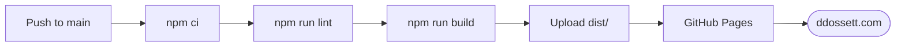

# David Dossett — Personal Website

[](https://astro.build)
[](https://www.typescriptlang.org)
[](https://nodejs.org)
[](.github/workflows/astro.yml)
[](https://ddossett.com)

A quiet, text-first personal website built with [Astro](https://astro.build) and deployed as a static site.

## At a Glance

| | |
|---|---|
| **Live site** | [ddossett.com](https://ddossett.com) |
| **Framework** | Astro 7 (static output) |
| **Language** | Astro components, TypeScript, CSS |
| **Hosting** | GitHub Pages (custom domain via `public/CNAME`) |
| **CI/CD** | GitHub Actions — check, build, deploy on push to `main` |

## Quick Start

```sh
npm install
npm run dev
```

## Scripts

| Command | What it does |
|---|---|
| `npm run dev` | Start the Astro dev server (alias: `npm start`) |
| `npm run lint` | Type-check the project with `astro check` |
| `npm run build` | Build the production site into `dist/` |
| `npm run preview` | Serve the production build locally |

## Project Structure

```text
├── public/              Static assets: fonts, images, favicons, CNAME
├── src/
│   ├── components/      Header, Experience, Projects, Footer
│   ├── layouts/         Layout.astro (shared page shell)
│   ├── pages/           index.astro, 404.astro
│   └── styles/          global.css
├── DESIGN.md            Design tokens and visual system
├── PRODUCT.md           Product purpose, users, and brand voice
└── astro.config.mjs     Astro config (site: https://ddossett.com)
```

## Deployment

Pushes to `main` trigger the [Deploy to Pages](.github/workflows/astro.yml) workflow.



## Design & Product

- 🎨 [`DESIGN.md`](DESIGN.md) — colors, typography, and design tokens
- 🧭 [`PRODUCT.md`](PRODUCT.md) — audience, purpose, and brand personality
